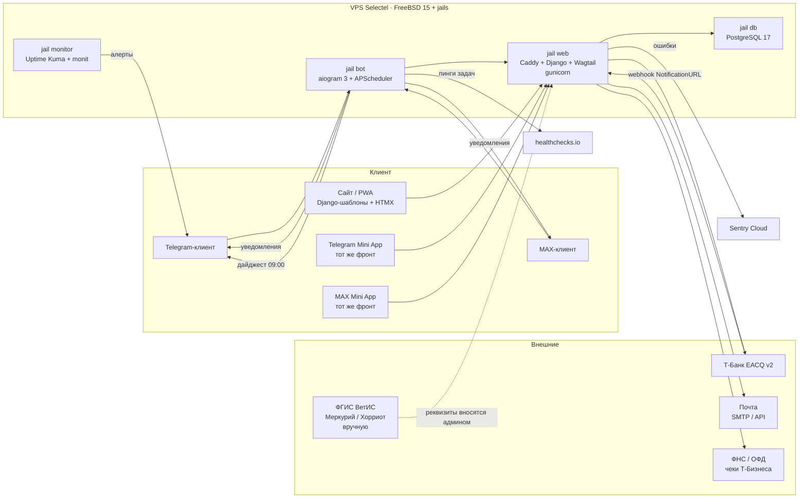

# Техническое задание
## Онлайн-магазин живых животных под заказ «Сельский двор»

**Версия:** 0.4 · **Дата:** 06.11.2026 · **Статус:** согласуется с заказчиком
**Заказчик:** Сельский двор (Алексей) · **Разработчик:** один человек, Python-профиль
**Основание:** клиентский макет MVP в `selskii-dvor/` (`index.html`, `lot.html`, `login.html`, `account.html`, `checkout.html`, `payment.html`, `preview.html`)
**План проекта:** [`ROADMAP.md`](./ROADMAP.md) — этапы, статусы, журнал решений
**Репозиторий:** https://github.com/avalok11/Selskii-dvor · **Рабочая папка:** `/Users/alexeyyarkov/opt/selskii-dvor/`

### Журнал версий

**0.4 · 06.11.2026** — стек, инфраструктура и мониторинг зафиксированы

| Изменение | Было | Стало |
|---|---|---|
| Стек | Next.js + NestJS + Prisma (предложено) | **Django 5.2 + Wagtail + HTMX + aiogram 3** (D15) |
| Инфраструктура | один VPS, мониторинг не выбран | **один VPS Selectel + S3 Selectel**, мониторинг: Uptime Kuma + Sentry + healthchecks.io (D16–D17) |
| Бизнес-мониторинг | не предусмотрен | **дашборд в админке + ежедневный дайджест в Telegram** (D18) |
| Статус продавца | ⛔ открыт | ✅ самозанятость (СМЗ), чеки «Чеки Т‑Бизнеса» (D13) |
| Домен | ⛔ открыт | ✅ `selskydvor.ru` (D14) |
| Вопрос про «Хорриот» | открыт | ⛔ отложен заказчиком, не выполнен |

**0.3 · 06.11.2026** — ребрендинг и репозиторий

| Изменение | Было | Стало |
|---|---|---|
| Название проекта | «Ферма Теремок» | **«Сельский двор»** (репозиторий `Selskii-dvor`) |
| Папка проекта | `mutton-shop/` | `selskii-dvor/` |
| Домен в примерах | `teremok.me` | `selskydvor.ru` (плейсхолдер, ⛔ подтвердить) |
| Репозиторий | не было | публичный GitHub-репозиторий (см. ROADMAP, раздел 3) |
| Фото в витрине | снимок мясных продуктов | кадр со стадом на пастбище |

**0.2 · 05.11.2026** — концепт «только живые животные», авторизация и история заказов

| Изменение | Было | Стало |
|---|---|---|
| Предмет продажи | живые животные **и мясо** | **только живые животные** |
| Документы | ветдокументы на мясо, убой, ВСЭ, «Честный ЗНАК» | учёт животных в «Хорриоте», ушная метка, ветдокументы на животное, чек 54‑ФЗ |
| Каталог | лоты + позиции «по кг» | лоты + **виды животных** с базовой сезонной ценой за кг |
| Авторизация | анонимный покупатель | **аккаунт: email / Telegram / MAX**, один аккаунт — три способа входа |
| Личный кабинет | не было | **«Мои заказы»**: история, статусы, оплата, документы, повторный заказ |
| Уведомления | только Telegram | Telegram **и** MAX, канал выбирает покупатель |

**0.1 · 05.11.2026** — первая версия: клиентский макет MVP, модель лотов и брони, выбор стека, юридическая часть.

---

## 0.1. Как вести этот документ

1. **Версия в шапке** = `X.Y · ДД.ММ.ГГГГ`. Каждое содержательное изменение требований — новая версия и новая строка в журнале версий выше.
2. **Маркеры ⛔ ТРЕБУЕТ ПОДТВЕРЖДЕНИЯ.** Когда вопрос решён — текст исправляется, маркер меняется на **✅ решено (дата)**, а в журнал решений ROADMAP (раздел 5) добавляется запись **D#** со ссылкой сюда.
3. **Согласованность документов.** SPEC отвечает на вопрос «что делаем», ROADMAP — «где мы сейчас». Требования меняются в SPEC, статус и решения — в ROADMAP. Дублировать одно и то же в оба файла нельзя.
4. **Чек-лист реализации.** Раздел 13.2 отмечается по мере закрытия пунктов: `[-]` в работе, `[x]` готово.
5. **Коммиты, меняющие требования,** ссылаются на номер решения в описании: `refs D5`.
6. **Порядок при нехватке времени:** приоритет — раздел 2 ROADMAP (критический путь 0 → 2 → 3 → 6 → 7 → 10). Статьи, PWA и полировка (этапы 8–9) режутся первыми.

---

## 0. Как пользоваться документом

Документ самодостаточен: его можно взять и разрабатывать приложение, не возвращаясь к переписке. В нём три слоя:

| Слой | Разделы | Зачем |
|---|---|---|
| **Что делаем** | 1–3, 6, 9, 10 | Бизнес-правила, роли, сценарии, экраны, документы |
| **Как делаем** | 4–5, 7–8, 11–12 | Архитектура, модели, API, бот, оплата, авторизация |
| **Когда и как проверим** | 13–15 | План работ, критерии приёмки, риски и открытые вопросы |

Все решения, которые ещё не подтверждены, помечены **⛔ ТРЕБУЕТ ПОДТВЕРЖДЕНИЯ** — они вынесены также в раздел 15.

---

## 1. Цель и границы

### 1.1. Бизнес-цель

Ферма продаёт **живых барашков и козлят под заказ**: у каждого животного есть номер, порода, возраст, живой вес, ушная метка, фото/видео и фиксированная цена. Покупатель выбирает конкретное животное, бронирует его, оплачивает депозит и забирает (или заказывает доставку) вместе с документами.

Ключевые особенности модели:

1. **Животное — это лот с индивидуальным номером**, а не «позиция прайса». Продать один и тот же барашка дважды нельзя, поэтому «стоп-лист» и «остаток» здесь — первостепенная функциональность.
2. **Мясо в проекте не продаётся.** Ни убоя, ни переработки, ни разруба, ни документов на мясную продукцию. Ферма отвечает за животное, его учёт и передачу.
3. **Покупателю нужен личный кабинет**: история заказов, статусы оплаты, документы и возможность повторить заказ. Отсюда — три способа входа.

### 1.2. Что входит в MVP

1. **Публичный адаптивный сайт** (телефон / планшет / десктоп):
   - витрина живых животных (лоты) и виды животных с базовой сезонной ценой;
   - карточка конкретного животного: фото, видео, характеристики, ушная метка, ветеринарный статус, история;
   - сезонный прайс с переключателем (весна / лето / осень–зима);
   - статьи «как мы выращиваем»;
   - оформление заказа в 3 шага;
   - экран оплаты: QR СБП, ссылка, таймер, чек.
2. **Аккаунт покупателя** с тремя способами входа:
   - **email** — одноразовый код из письма (6 цифр, TTL 10 минут);
   - **Telegram** — вход по подписанным `initData` мини-приложения;
   - **MAX** — вход по подписанным `initData` мини-приложения;
   - способы **привязываются к одному аккаунту**: вошёл по email — потом привязал Telegram и MAX.
3. **Личный кабинет «Мои заказы»**: список заказов с фильтром по статусу, статус оплаты, действия (оплатить депозит, документы, задать вопрос, повторить заказ), профиль и список привязанных аккаунтов.
4. **Telegram-бот как пульт администратора**: заказы и вопросы приходят в ТГ, админ формирует ссылку на оплату, вешает и снимает бронь, меняет цены, снимает товар с продажи, прикладывает документы.
5. **MAX-бот** — доставка клиентских уведомлений в MAX (на этапе MVP — только уведомления, без админских команд).
6. **Оплата через Т‑Банк EACQ API v2**: СБП (динамический QR) и карта, вебхук, фискальный чек 54‑ФЗ.
7. **Депозит 30% + остаток при передаче животного**, бронь 24 часа, автоистечение.
8. **Фиксация ветеринарных реквизитов** (УНСМ, номер/дата эВСД, документы) — **вручную админом**, без интеграции с «Меркурием»/«Хорриотом».

### 1.3. Что НЕ входит в MVP (осознанно)

| Не делаем | Почему | Когда возьмём |
|---|---|---|
| Убой, переработка, разруб, продажа мяса | Другая юридическая и операционная модель, другой документооборот | Отдельный проект, если спрос вырастет |
| Маркировка «Честного ЗНАК» | К живому животному не применяется | Не планируется |
| Интеграция с «Меркурием» / «Хорриотом» | Требует аккредитации и ЭДО; данных мало | Не планируется |
| Доставка животных за пределы 30 км от фермы | Ветеринарные документы на перевозку, сложная логистика | После отладки ближней зоны |
| Объявления о продаже животных без индивидуального лота | Размывает главную идею «конкретный барашек» | Не планируется |
| Онлайн-видеотрансляция с фермы | Требования к каналу связи | Не планируется |
| Нативные приложения iOS/Android | Требовался адаптивный веб | Не планируется |
| Расчёт доставки через СДЭК/Boxberry API | Животных возят своим транспортом, цена фиксированная | Не планируется |

### 1.4. Ключевые допущения

| # | Допущение | Статус |
|---|---|---|
| A1 | Продажа — физлицам и частично организациям (ресторанам) | ⛔ подтвердить |
| A2 | Статус продавца: **самозанятость (СМЗ, НПД)**, чеки — «Чеки Т‑Бизнеса» | ✅ решено 06.11.2026 (см. ROADMAP D13) |
| A3 | Транспортировка животных — своим хозтранспортом, зоотранспорт для дальних перевозок — на аутсорсе | ⛔ подтвердить |
| A4 | Депозит 30%, бронь 24 часа, остаток — при передаче животного | ⛔ подтвердить |
| A5 | Получение: самовывоз с фермы (бесплатно) или доставка в радиусе 30 км (900 ₽) | ⛔ подтвердить |
| A6 | Ассортимент: барашки и козлята | подтверждено по макету |
| A7 | Домен и TLS: **`selskydvor.ru`**, почта на собственном домене | ✅ решено 06.11.2026 (см. ROADMAP D14) |
| A8 | Аккаунт обязателен для просмотра истории, но **не** для оформления заказа | ⛔ подтвердить |
| A9 | MAX используется как клиентский канал (вход + уведомления), админский пульт остаётся в Telegram | ⛔ подтвердить |
| A10 | Уведомления дублируются во все привязанные мессенджеры | ⛔ подтвердить |

---

## 2. Роли и пользовательские сценарии

### 2.1. Роли

| Роль | Как входит | Что может |
|---|---|---|
| **Гость** | Сайт (анонимно) | Смотреть каталог, читать статьи, задать вопрос, оформить заказ |
| **Покупатель** | Сайт / Telegram Mini App / MAX Mini App, после входа | Всё, что гость, **плюс** история заказов, статусы, документы, повторный заказ, привязка мессенджеров |
| **Администратор** | Telegram-бот (один аккаунт) + веб-админка (браузер) | Управлять лотами и ценами, видеть заказы и вопросы, формировать ссылку на оплату, прикладывать документы |
| **Система** | Фоновые задачи | Истечение брони, отправка уведомлений, сверка статуса платежа, отправка кодов на email |

Авторизация администратора: **белый список Telegram ID** для бота + веб-админка с отдельной учёткой. Публичной регистрации нет.

### 2.2. Ключевые сценарии

| ID | Сценарий | Критерий выполнения |
|---|---|---|
| **C1** | Гость открывает каталог с телефона | Каталог грузится ≤ 2,5 с на 4G, карточки в одну колонку, меню-бургер работает |
| **C2** | Покупатель выбирает барашка №12 | Видит фото, видео, вес, породу, возраст, корм, ушную метку, ветстатус, цену и условия брони |
| **C3** | Покупатель оформляет заказ | 3 шага: данные → оплата → ссылка; итоговая сумма всегда на экране; сумма считается на сервере |
| **C4** | Покупатель платит депозит по QR | QR открывает СБП; после оплаты заказ переходит в `paid` автоматически; чек приходит на e-mail |
| **C5** | Бронь не оплачена за 24 ч | Лот автоматически возвращается в продажу, уведомление админу в ТГ |
| **C6** | Админ получает заказ | В ТГ приходит карточка: животное, сумма, контакты, кнопки «Ссылка на оплату» / «Отменить» |
| **C7** | Админ формирует ссылку на оплату | Ссылка и QR уходят покупателю в мессенджер и показываются на экране оплаты; срок жизни — 60 минут |
| **C8** | Админ снимает животное с продажи | Лот исчезает из витрины в течение секунды; в админке остаётся история |
| **C9** | Покупатель задаёт вопрос | Вопрос приходит админу в ТГ; ответ уходит покупателю в ТГ/MAX и в чат личного кабинета |
| **C10** | Покупатель оформляет заказ с указанием «для организации» | В заказе фиксируется тип покупателя; админ получает задачу на оформление ветеринарных документов на перевозку |
| **C11** | Админ выдаёт документы на животное | К заказу прикрепляются фото/PDF, покупатель видит их в личном кабинете и в мессенджере |
| **C12** | Покупатель меняет сезон в прайсе | Таблица цен переключается без перезагрузки, активный сезон подсвечен |
| **C13** | **Вход по email** | Покупатель вводит адрес → получает 6-значный код → входит; код одноразовый, TTL 10 минут, не более 3 попыток |
| **C14** | **Вход через Telegram** | Вход из мини-приложения без пароля; `initData` проверяется на сервере; покупатель сразу попадает в кабинет |
| **C15** | **Вход через MAX** | То же, что C14, но через `window.WebApp.initData`; при отсутствии привязки — вход по email-коду с последующей привязкой MAX |
| **C16** | **История заказов** | Покупатель видит все свои заказы с датой, животным, суммой, статусом оплаты и доступными действиями |
| **C17** | **Повторный заказ** | Из завершённого заказа можно в один тап перейти к каталогу с предзаполненным фильтром по тому же виду животного |
| **C18** | **Привязка второго способа входа** | В кабинете привязывается Telegram или MAX к существующему аккаунту; после привязки уведомления идут в оба канала |
| **C19** | **Выход** | Сессия завершается на всех устройствах, доступ к истории закрыт |

---

## 3. Бизнес-правила

### 3.1. Лот (эксклюзивная продажа)

```
Лот = конкретное животное:
  номер (№12) · вид (барашек / козлёнок) · порода · пол · дата рождения
  живой вес (кг) · ушная метка (УНСМ) · ветеринарный статус
  фото · видео · фиксированная цена (₽) · статус · срок брони · история
```

**Статусы лота:**

| Статус | Когда | Виден покупателю | Что делает |
|---|---|---|---|
| `available` | новое животное или истёкшая бронь | да, в каталоге | доступно к брони |
| `reserved` | на него оформлен заказ, ждём оплату | да, с бейджем «Забронирован» | действует `holdUntil` |
| `sold` | оплачен или передан | да, с бейджем «Продан», фото приглушено | недоступен |
| `expired` | снят админом (ветотвод, резерв, качество) | скрыт | снят с продажи |
| `draft` | заведён, не опубликован | нет | заготовка |

**Правило целостности:** один лот не может быть в двух активных заказах. Реализуется уникальным индексом на `Lot` в заказах со статусом не отменённым + проверкой внутри транзакции.

**Стоп-лист — два независимых механизма:**

1. **Ручной.** `Lot.status = expired` → животное исчезает из витрины; для вида животного — `AnimalType.isActive = false` → исчезают все лоты этого вида. Причина (`stopReason`) сохраняется.
2. **Автоматический (остаток).** Лот в `reserved`/`sold` не показывается как доступный. Если у вида животного нет ни одного лота в `available` — вид уходит в конец витрины с пометкой «разобрано».

### 3.2. Сезонные цены и расчёт цены животного

- Сезонов ровно три: **весна (март–май), лето (июнь–август), осень–зима (сентябрь–февраль)**. Смена цен — 3 раза в год.
- Для каждого вида животного (барашек, козлёнок, ягнёнок) хранится **базовая цена за кг живого веса** в каждом сезоне.
- **Цена конкретного лота** = базовая цена текущего сезона × живой вес, округление до рубля. Цена фиксируется **в момент публикации лота** и больше не меняется — сезонные изменения цен не переписывают уже выставленных животных.
- Прайс на сайте показывает **текущий** сезон; остальные доступны переключателем (как в макете).
- В строки заказа цена копируется **снимком**. Изменение прайса никогда не переписывает существующие заказы.

**Пример:** барашек, лето, 690 ₽/кг, живой вес 19,4 кг → 13 386 ₽ (в макете показан лот за 14 400 ₽ с округлением «по ферме» — допускается ручная цена админа, она приоритетнее расчётной).

### 3.3. Бронь и оплата

1. Покупатель оформляет заказ → лот переходит в `reserved`, `holdUntil = now + 24 ч`, статус заказа `awaiting_payment`.
2. Админ (или покупатель по кнопке в кабинете) создаёт платёж: Т‑Банк `Init` → `GetQr` для СБП → ссылка + QR.
3. Успешная оплата → заказ `paid`, лот `sold`, бронь снимается.
4. Истечение `holdUntil` без оплаты → лот `available`, заказ `expired`, админу приходит уведомление, покупателю — в мессенджер.
5. **Остаток (70%)** — второй платёж при передаче животного (на ферме или при доставке).
6. Если депозит не поступил за 24 ч — лот возвращается в продажу без ручного действия админа.

**Возврат:** депозит возвращается полностью, если животное не передано в согласованный срок. Возврат — через Т‑Банк (`Cancel`), с закрывающим чеком.

### 3.4. Документы на животное

| Документ | Когда нужен | Кто оформляет |
|---|---|---|
| Ушная метка (УНСМ) | всегда | ветеринарная служба, на ферме; номер вносится в систему вручную |
| Учёт в «Хорриоте» (ФГИС «ВетИС») | всегда | ветеринарная служба; подтверждение вносится в карточку лота |
| Ветеринарный осмотр, сведения о прививках | всегда | ветслужба; результат — в карточке лота |
| Ветеринарные сопроводительные документы (эВСД ф. № 1) | при реализации организации или при перевозке | ветеринарная служба по заявке; номер и дата — в системе |
| Документы на перевозку | при доставке животного | ветеринарная служба |
| Кассовый чек 54‑ФЗ | на каждую оплату | Т‑Банк «Чеки Т‑Бизнеса», автоматически |
| Расписка / УПД | сделка с физлицом / юрлицом | система формирует шаблон, админ подписывает |

**Принцип:** система не подменяет ветеринарные службы. Она **фиксирует реквизиты**, введённые человеком, прикладывает сканы и показывает покупателю, что документы есть. Ключевой флаг в заказе — `purpose`: `personal` (для личного потребления) или `business` (для организации, нужны документы на перевозку).

### 3.5. Условия, показываемые покупателю

- Бронь 24 часа с момента оформления заказа.
- Депозит 30%, остаток — при передаче животного.
- Возврат депозита, если срок передачи нарушен.
- Животное остаётся на ферме до передачи, ухаживает за ним продавец.
- Чеки 54‑ФЗ на каждую оплату.
- Документы на животное выдаются вместе с ним, копия — в личном кабинете и в мессенджере.

---

## 4. Архитектура

### 4.1. Общая схема



### 4.2. Стек и обоснование

| Слой | Технология | Почему именно это |
|---|---|---|
| Бэкенд и API | **Django 5.2 LTS + Django Ninja** | Один процесс: сайт, API, ORM, миграции, админка. Ninja даёт типизированные хендлеры, Pydantic‑валидацию и OpenAPI‑документацию |
| CMS | **Wagtail 6.x** поверх Django | Статьи «как выращиваем» с визуальным редактором; лоты и цены — обычные Django‑модели рядом |
| Фронт | **Django‑шаблоны + HTMX + Alpine.js**, CSS из текущего макета | Без SPA и без Node‑сборки: готовые макеты переносятся как есть, интерактив — точечные HTMX‑фрагменты |
| Админка | **Django admin** + две кастомные страницы | Цены, стоп‑лист, лоты, заказы, документы — из коробки, без самописного CRUD |
| Бот | **aiogram 3** | Python и async, long polling, та же кодовая база, что и сайт |
| Telegram / MAX Mini App | **Telegram WebApp JS** и **MAX Bridge** (`max-web-app.js`) | Тот же шаблон сайта в WebView; вход по подписанным `initData` |
| ORM и БД | **Django ORM + PostgreSQL 17** | Миграции, ограничения на брони, `JSONField` для чеков и вебхуков |
| Валидация | **Pydantic v2** (в Ninja) и **Django forms** (в админке) | Одни и те же правила для API и форм |
| Письма | **SMTP Selectel** (или внешний сервис) | Одноразовые коды входа и чеки |
| Оплата | **httpx** к API Т‑Банка (EACQ v2) | Четыре метода, свой тонкий клиент, SDK не нужен |
| Медиа | **S3 Selectel + CDN**, presigned‑загрузка | Фото и видео животных, сканы документов; сервер отдаёт только подписанные ссылки |
| Фоновые задачи | **APScheduler** (в процессе бота) + cron в jail | Истечение брони, отправка кодов, сверка платежей — без Celery и Redis |
| CI | **GitHub Actions** | Линт, тесты, деплой по `git pull` |

**Почему без Node во фронте.** Макеты уже написаны на чистом CSS с адаптивом — их переносим как дизайн‑систему без пересборки. Tailwind подключаем позже и только если понадобится; это не блокирует этапы 2–7. На FreeBSD сборка Node‑инструментов добавила бы ещё один слой (npm, node‑gyp, нативные модули) — лишняя сложность на старте.

**Альтернативы и почему отвергнуты:** Next.js + NestJS — единый TypeScript и богаче фронт, но это новый для вас язык и лишние подсистемы (SSR, ORM, сборка) для одного человека; WordPress + WooCommerce — тяжёлая интеграция с ТГ/MAX, вебхуками и бронями; Strapi — своя админка поверх готовой, лишняя RAM и две системы прав; SPA на React — Django и так даёт SSR и SEO для статей.

> ✅ **Решено 06.11.2026 (D15):** стек — **Django 5.2 + Wagtail + HTMX + aiogram 3**. Цена решения: фронт не получит «нативного» ощущения SPA, но для этого проекта (каталог, форма, кабинет) оно не требуется, а скорость разработки и администрирования для соло‑разработчика выше в разы.

### 4.3. Структура монорепо

```
selskii-dvor/
├── config/                  # settings, urls, asgi/wsgi, logging
├── apps/
│   ├── catalog/             # Season, AnimalType, Price, Lot + Article (Wagtail)
│   ├── orders/              # Order, OrderItem, бронь, статусы, расписка
│   ├── payments/            # клиент Т‑Банка, вебхук, чеки 54‑ФЗ
│   ├── accounts/            # User, UserIdentity, EmailCode, вход, сессии
│   ├── notifications/       # письма, тексты для ТГ/MAX, шаблоны
│   ├── monitoring/          # метрики, дашборд, дайджест
│   ├── api/                 # Django Ninja: /api/v1/*
│   └── bot/                 # aiogram 3: админ‑пульт и уведомления
├── templates/               # HTML из макета + HTMX‑фрагменты
├── static/                  # CSS и JS из макета (дизайн‑система)
├── media/                   # локальные файлы в dev (в проде — S3)
├── infra/
│   ├── freebsd/             # Bastillefile, jail‑конфиги, pf.conf
│   └── scripts/             # deploy.sh, backup.sh, seed.py
├── docs/
│   ├── SPEC.md              # этот документ
│   ├── ROADMAP.md           # план и журнал решений
│   └── runbook.md           # эксплуатация: бэкапы, ротация, инциденты
├── manage.py
├── requirements.txt
├── .github/workflows/ci.yml
└── .env.example
```

### 4.4. Схема данных (ER)

```mermaid
erDiagram
  USER ||--o{ USER_IDENTITY : "имеет способы входа"
  USER ||--o{ ORDER : "оформляет"
  USER ||--o{ EMAIL_CODE : "получает коды"
  SEASON ||--o{ PRICE : "задаёт базовые цены"
  ANIMAL_TYPE ||--o{ PRICE : "имеет цену за кг"
  ANIMAL_TYPE ||--o{ LOT : "выпускается лотами"
  LOT ||--o{ ORDER_ITEM : "продаётся"
  ORDER ||--|{ ORDER_ITEM : "состоит из"
  ORDER ||--o{ PAYMENT : "оплачивается"
  ORDER ||--o{ QUESTION : "порождает вопросы"
  ORDER ||--o{ VET_DOC : "сопровождается документами"
  LOT }o--o| VET_DOC : "имеет ветдокументы"

  USER { string id PK ; string email ; string phone ; string name ; datetime createdAt }
  USER_IDENTITY { string id PK ; string userId FK ; string provider ; string providerUserId ; string username ; datetime linkedAt }
  EMAIL_CODE { string id PK ; string email ; string codeHash ; datetime expiresAt ; int attempts }
  SEASON { string id PK ; string key ; date from ; date to }
  ANIMAL_TYPE { string id PK ; string slug ; string title ; bool isActive ; string stopReason }
  PRICE { string id PK ; string seasonId FK ; string animalTypeId FK ; int pricePerKg }
  LOT { string id PK ; string code ; string animalTypeId FK ; int weightLive ; int priceTotal ; string status ; datetime holdUntil ; string usnm ; string vetStatus }
  ORDER { string id PK ; string number ; string userId FK ; string purpose ; string status ; string customerName ; string phone ; string deliveryMethod ; int subtotal ; int deposit ; int balance ; int deliveryFee ; int total }
  ORDER_ITEM { string id PK ; string orderId FK ; string lotId FK ; int qty ; int priceSnapshot }
  PAYMENT { string id PK ; string orderId FK ; string provider ; string providerPaymentId ; int amount ; string kind ; string status ; string confirmationUrl ; JSON receipt }
  QUESTION { string id PK ; string orderId FK ; string userId FK ; string text ; string status }
  VET_DOC { string id PK ; string orderId FK ; string lotId FK ; string kind ; string number ; date issuedAt ; string fileUrl }
```

---

## 5. Модель данных (Django ORM)

> Таблицы ниже — логическая схема. В Django это модели внутри приложений (`apps/catalog/models.py`, `apps/orders/models.py` и т. д.). Первичные ключи — `UUIDField(default=uuid4, primary_key=True)`, внешние — `ForeignKey(..., on_delete=PROTECT)` для лотов, заказов и документов (не теряем историю продажи). Денежные суммы — **целые рубли** (`PositiveIntegerField`), вес — `DecimalField(max_digits=6, decimal_places=2)`. Уникальность и индексы задаём на уровне БД (`UniqueConstraint`, `Index`), а не только в коде: пара `(season, animal_type)`, `(provider, provider_user_id)` у способов входа, `lot` в активных заказах. Имена полей — `snake_case` в БД, `camelCase` в API.

### 5.1. `User` (аккаунт покупателя)

| Поле | Тип | Описание |
|---|---|---|
| `id` | uuid PK | |
| `email` | string? unique | основной идентификатор для входа по почте |
| `emailVerifiedAt` | datetime? | |
| `phone` | string? | из формы заказа или Telegram/MAX-профиля |
| `name` | string? | имя для документов и «Привет, …» |
| `createdAt` / `lastSeenAt` | datetime | |

Аккаунт **не обязан** иметь email: вход через мессенджер создаёт аккаунт с пустым `email`, а email привязывается позже.

### 5.2. `UserIdentity` (привязанный способ входа)

| Поле | Тип | Описание |
|---|---|---|
| `id` | uuid PK | |
| `userId` | FK User | |
| `provider` | enum `email\|telegram\|max` | |
| `providerUserId` | string? | id пользователя в Telegram/MAX; для email — `email` |
| `username` | string? | @username в мессенджере |
| `linkedAt` | datetime | |

**Уникальность:** пара `(provider, providerUserId)` — один Telegram-аккаунт не может быть привязан к двум пользователям. `providerUserId` для email = нормализованный email.

### 5.3. `EmailCode`

| Поле | Тип | Описание |
|---|---|---|
| `id` | uuid PK | |
| `email` | string | нормализованный |
| `codeHash` | string | **только хэш**, код в открытом виде не храним |
| `expiresAt` | datetime | +10 минут |
| `attempts` | int | максимум 3 попытки |
| `usedAt` | datetime? | |

Правила выдачи: не чаще 1 кода в 60 секунд на адрес, не более 5 кодов в час на адрес и не более 10 на IP в час.

### 5.4. Сессии и вход

Сессии — **встроенные `django.contrib.sessions`** с backend на базе (таблица `django_session`), cookie `sessionid` (`httpOnly`, `Secure`, `SameSite=Lax`), `SESSION_COOKIE_AGE = 30 дней`, `SESSION_SAVE_EVERY_REQUEST = True`. Отдельную модель `Session` не заводим.

| Что | Где | Детали |
|---|---|---|
| Сессия | `django.contrib.sessions` | 30 дней, продлевается при активности |
| Идентичности | `accounts.UserIdentity` | привязка способов входа к аккаунту, уникальность `(provider, provider_user_id)` |
| Коды входа | `accounts.EmailCode` | только хэш, TTL 10 минут, 3 попытки, rate limit |
| CSRF | `django.middleware.csrf` | cookie `csrftoken` + заголовок `X-CSRFToken` на мутациях |
| Гостевой заказ | `orders.GuestToken` | одноразовый подписанный токен, чтобы забрать заказ в аккаунт |

Вход через мессенджер дополнительно фиксируется в `UserIdentity` — по ней потом уходят уведомления.

### 5.5. `Season`

| Поле | Тип | Описание |
|---|---|---|
| `id` | uuid PK | |
| `key` | enum `spring\|summer\|winter` unique | |
| `label` | string | «Весна · март–май» |
| `startsAt` / `endsAt` | date | окно действия |
| `isActive` | bool | текущий для витрины |

### 5.6. `AnimalType` (вид животного)

| Поле | Тип | Описание |
|---|---|---|
| `id` | uuid PK | |
| `slug` | string unique | `barashok`, `kozyonok`, `yagnyonok` |
| `title` | string | «Барашек» |
| `description` | text | карточка для покупателя |
| `breed` | string | «белая курдючная» |
| `isActive` | bool default true | **стоп-лист вида**: false → все лоты вида скрыты |
| `stopReason` | string? | причина |
| `imageUrl` / `videoUrl` | string? | |
| `sortOrder` | int | порядок в витрине |

### 5.7. `Price`

| Поле | Тип | Описание |
|---|---|---|
| `id` | uuid PK | |
| `seasonId` | FK Season | |
| `animalTypeId` | FK AnimalType | |
| `pricePerKg` | int | базовая цена ₽/кг живого веса |
| unique(`seasonId`,`animalTypeId`) | | |

### 5.8. `Lot` (конкретное животное)

| Поле | Тип | Описание |
|---|---|---|
| `id` | uuid PK | |
| `code` | string unique | «12» → «Барашек №12» |
| `animalTypeId` | FK AnimalType | |
| `breed` | string | |
| `sex` | enum `male\|female` | |
| `bornAt` | date | из него считается возраст |
| `weightLive` | int | кг, живой вес |
| `priceTotal` | int | фиксированная цена за животное |
| `priceAuto` | bool | true → цена рассчитана по сезонному прайсу |
| `status` | enum `draft\|available\|reserved\|sold\|expired` | |
| `holdUntil` | datetime? | конец брони (24 ч) |
| `reservedByOrderId` | uuid? FK | защита от двойной брони |
| `usnm` | string? | номер ушной метки («Хорриот») |
| `vetStatus` | enum `none\|requested\|issued\|not_required` | статус ветдокументов |
| `vetNotes` | text? | прививки, осмотры, результаты исследований |
| `history` | text? | «родился 12 марта, мать — овца №41» |
| `videoUrl` / `imageUrl` | string? | |
| `viewCount` | int | счётчик просмотров карточки — база для конверсии (см. 11.2) |
| `publishedAt` / `createdAt` | datetime | |

### 5.9. `Order`

| Поле | Тип | Описание |
|---|---|---|
| `id` | uuid PK | |
| `number` | string unique | «№37» (счётчик + год) |
| `userId` | FK User? | null для гостя |
| `status` | enum | см. 5.11 |
| `purpose` | enum `personal\|business` | для личного потребления или для организации |
| `customerName` / `phone` | string | контакты покупателя (копируются из аккаунта, но редактируются) |
| `email` | string? | для чека |
| `deliveryMethod` | enum `pickup\|delivery` | самовывоз с фермы или доставка |
| `address` | string? | при доставке |
| `desiredDate` | date? | желаемая дата передачи |
| `comment` | text? | пожелания |
| `subtotal` / `depositAmount` / `balanceAmount` / `deliveryFee` / `total` | int | |
| `paidDepositAt` / `paidBalanceAt` / `handedOverAt` | datetime? | |
| `createdAt` | datetime | |

### 5.10. `OrderItem`

| Поле | Тип | Описание |
|---|---|---|
| `id` | uuid PK | |
| `orderId` | FK Order | |
| `lotId` | FK Lot | всегда конкретное животное |
| `qty` | int | 1 |
| `priceSnapshot` | int | **цена на момент заказа** |
| `lotCodeSnapshot` | string | «Барашек №12» — на случай переименования |

### 5.11. Статусы заказа

```
new → awaiting_payment → paid → preparing → ready → handed_over
  └────────────→ expired (бронь истекла)
  └────────────→ canceled (админ)
  └────────────→ refunded (возврат депозита)
```

| Статус | Что значит | Действия |
|---|---|---|
| `new` | заказ создан, платёж не инициирован | админ формирует ссылку |
| `awaiting_payment` | платёж создан, ждём оплату | автоистечение через 24 ч |
| `paid` | депозит получен | животное готовится к передаче |
| `preparing` | идут документы и передача | — |
| `ready` | готово к передаче | чек на остаток |
| `handed_over` | животное передано, остаток оплачен | закрытие |
| `expired` / `canceled` / `refunded` | лот вернулся в продажу / отмена / возврат | — |

### 5.12. `Payment`

| Поле | Тип | Описание |
|---|---|---|
| `id` | uuid PK | |
| `orderId` | FK Order | |
| `provider` | enum `tbank` | |
| `providerPaymentId` | string? | `PaymentId` Т‑Банка |
| `providerOrderId` | string | наш `OrderId` для Т‑Банка (≤50 симв.) |
| `amount` | int | |
| `kind` | enum `deposit\|balance` | депозит или остаток |
| `status` | enum `pending\|succeeded\|canceled` | |
| `confirmationUrl` / `sbpPayload` | string? | |
| `receipt` | JSONField? | объект `Receipt` для 54‑ФЗ |
| `createdAt` / `paidAt` | datetime? | |

### 5.13. `Question`

| Поле | Тип | Описание |
|---|---|---|
| `id` | uuid PK | |
| `orderId` | FK Order? | |
| `userId` | FK User? | |
| `customerName` / `username` / `text` | | |
| `channel` | enum `web\|telegram\|max` | где задан |
| `status` | enum `new\|answered\|closed` | |
| `createdAt` / `answeredAt` | datetime? | |

### 5.14. `VetDoc`

| Поле | Тип | Описание |
|---|---|---|
| `id` | uuid PK | |
| `orderId` | FK Order? | |
| `lotId` | FK Lot? | |
| `kind` | enum `horriot_extract\|evs1\|transport\|other` | выписка / эВСД / перевозка / прочее |
| `number` / `issuedAt` | | |
| `fileUrl` | string | скан/фото в S3 |

---

## 6. API

Базовый путь `/api/v1`. Формат ошибок единый:

```json
{ "error": { "code": "LOT_ALREADY_RESERVED", "message": "Лот уже забронирован" } }
```

Аутентификация — **сессия в httpOnly-cookie** `sid`; для мессенджерных Mini App дополнительно принимается заголовок `X-Init-Data` (Telegram/MAX), который проверяется и превращается в сессию.

### 6.1. Публичные методы (сайт и Mini App)

> Все пути в таблице указаны **относительно префикса `/api/v1`** (Django Ninja). В примерах ниже префикс опущен для краткости.

| Метод | Путь | Назначение | Кэш |
|---|---|---|---|
| GET | `/lots` | Витрина: `?status=available&type=barashok&season=summer&limit&cursor` | 60 с |
| GET | `/lots/{code}` | Карточка лота | 60 с |
| GET | `/animal-types` | Виды животных | 300 с |
| GET | `/animal-types/{slug}` | Карточка вида | 300 с |
| GET | `/prices?season=summer` | Базовые цены за кг | 300 с |
| GET | `/seasons` | Список сезонов + активный | 3600 с |
| GET | `/articles` , `/articles/{slug}` | Статьи (кэш/ISR) | 3600 с |
| POST | `/orders` | Создать заказ → `{order, deposit, payment}` | — |
| GET | `/orders/{number}?token=…` | Статус заказа по одноразовому токену из ссылки | — |
| POST | `/orders/{number}/questions` | Задать вопрос по заказу | — |

### 6.2. Авторизация

| Метод | Путь | Назначение |
|---|---|---|
| POST | `/auth/email/request` | `{email}` → отправка 6-значного кода. Ответ: `{sent: true, retryAfterSec}` |
| POST | `/auth/email/verify` | `{email, code}` → сессия + `UserIdentity(email)` |
| POST | `/auth/telegram` | Заголовок `X-Init-Data: <initData>` → сессия + `UserIdentity(telegram)` |
| POST | `/auth/max` | Заголовок `X-Init-Data: <initData>` → сессия + `UserIdentity(max)` |
| POST | `/auth/logout` | Завершить текущую сессию |
| GET | `/auth/me` | Текущий пользователь + список привязанных способов |
| GET | `/auth/sessions` | Активные сессии (устройства) — для выхода со всех |
| POST | `/auth/identities/email` | Привязать email к текущему аккаунту (шаг с кодом) |
| POST | `/auth/identities/telegram` | Привязать Telegram (по `initData`) |
| POST | `/auth/identities/max` | Привязать MAX (по `initData`) |
| DELETE | `/auth/identities/{id}` | Отвязать способ (нельзя отвязать последний) |

**Правила:**

1. **Telegram:** сервер строит `data_check_string` из всех полей `initData`, сортирует по ключу, склеивает `key=value` через `\n`, добавляет строку с хэшем, считает **HMAC-SHA256** с ключом `sha256("WebAppData" + bot_token)`, сравнивает с `hash` из `initData`. Дополнительно сверяем `auth_date` (не старше 1 часа) и `query_id` на повтор.
2. **MAX:** аналогично, но по документации MAX — сверка подписи `hash` из `window.WebApp.initData` сервером (страница «Валидация» на dev.max.ru), проверка `auth_date` (≤ 5 минут) и уникальность `query_id` в пределах часа. Проверяющая реализация — на сервере, ключ выводится из токена бота: `HMAC-SHA256(key="WebAppData", msg=bot_token)`.
3. **Email:** код — 6 цифр, TTL 10 минут, максимум 3 попытки, хэш в БД, код не логируется. При превышении лимитов — 429 с `Retry-After`.
4. **Привязка способа** к уже вошедшему аккаунту: способ, который уже привязан к другому аккаунту, привязать нельзя — возвращаем `IDENTITY_ALREADY_LINKED` с предложением войти через него.
5. **Гостевой заказ** (без аккаунта) допускается: у заказа остаётся `userId = null`, а покупателю выдаётся **одноразовый токен** в ссылке «Мои заказы» — по нему можно позже забрать заказ в аккаунт (см. `POST /me/orders/claim`).
6. **Сессия** — стандартная Django: cookie `sessionid` (httpOnly, Secure, SameSite=Lax), 30 дней. Состояние авторизации недоступно из JS — страницы рендерит сервер, динамические данные берутся из `GET /api/v1/auth/me`.
7. **Мутации** требуют CSRF‑токен (double‑submit: cookie `csrftoken` + заголовок `X-CSRFToken`); для Mini App — заголовок `X-Init-Data` вместо CSRF (данные подписаны мессенджером).

### 6.3. Личный кабинет

| Метод | Путь | Назначение |
|---|---|---|
| GET | `/me` | Профиль: имя, телефон, email, привязанные способы |
| PATCH | `/me` | Обновить имя/телефон |
| GET | `/me/orders?status=…` | Список заказов (новые сверху), с пагинацией |
| GET | `/me/orders/{number}` | Детальная карточка заказа: позиции, платежи, документы, вопросы |
| POST | `/me/orders/{number}/payment-link` | Создать/пересоздать ссылку на оплату (и покупатель, и админ) |
| POST | `/me/orders/{number}/questions` | Задать вопрос по заказу |
| GET | `/me/orders/{number}/documents` | Список документов на животное |
| POST | `/me/orders/claim` | Забрать гостевой заказ в аккаунт по одноразовому токену |
| POST | `/me/reorder/{number}` | Вернуть на каталог с предзаполненным фильтром |

### 6.4. Методы администратора

Аутентификация: сессия админа или Telegram `initData` от админского аккаунта.

| Метод | Путь | Назначение |
|---|---|---|
| GET | `/admin/lots` | Список лотов с фильтрами |
| POST | `/admin/lots` | Создать/изменить лот (в т.ч. авторасчёт цены по сезону) |
| POST | `/admin/lots/{id}/hold` | Взять в бронь вручную |
| POST | `/admin/lots/{id}/release` | Снять бронь, вернуть в продажу |
| POST | `/admin/lots/{id}/status` | Сменить статус (`expired`, `sold`, `available`) |
| POST | `/admin/lots/{id}/vet` | Внести УНСМ и ветеринарный статус |
| POST | `/admin/animal-types/{id}/stop` | Поставить вид на стоп-лист |
| POST | `/admin/animal-types/{id}/resume` | Вернуть вид в продажу |
| PUT | `/admin/prices` | Массовое изменение базовых цен сезона |
| GET | `/admin/orders` | Список заказов с фильтрами |
| GET | `/admin/orders/{number}` | Карточка заказа |
| POST | `/admin/orders/{number}/payment-link` | Создать платёж Т‑Банка → `{url, qr, expiresAt}` |
| POST | `/admin/orders/{number}/cancel` | Отменить заказ, освободить лот |
| POST | `/admin/orders/{number}/documents` | Прикрепить документ (файл → S3) |
| POST | `/admin/orders/{number}/status` | Сменить статус вручную |
| GET | `/admin/questions` | Вопросы |
| POST | `/admin/questions/{id}/reply` | Ответ (уходит покупателю в мессенджер и в кабинет) |
| GET | `/admin/users` | Поиск покупателей (для сверки и поддержки) |

### 6.5. Вебхуки

| Метод | Путь | Источник | Обработка |
|---|---|---|---|
| POST | `/webhooks/tbank` | Т‑Банк | Проверка `Token`, затем `GET /v2/GetState`, сверка суммы и `OrderId`, идемпотентная смена статуса |
| POST | `/webhooks/telegram` | Telegram | Опционально, если бот работает на webhook вместо polling |

### 6.6. Правила API

- Суммы приходят только с сервера: клиент передаёт `lotId`, сервер считает `subtotal`, `deposit`, `total`. Значение суммы от клиента **игнорируется**.
- Идемпотентность создания заказа: заголовок `Idempotency-Key` (uuid), повтор с тем же ключом возвращает тот же заказ.
- Все списки — cursor-пагинация, `limit` по умолчанию 24, максимум 100.
- Rate limit: `/orders` — 5 в час с одного IP; `/questions` — 10 в час; `/auth/email/request` — 1 в минуту на адрес, 5 в час на адрес, 10 в час на IP.

---

## 7. Telegram- и MAX-боты

### 7.1. Telegram: пульт администратора

| Команда | Действие |
|---|---|
| `/start` | справка и текущие лоты |
| `/lots` | список лотов со статусами (кнопки: «Снять с продажи», «Назначить цену») |
| `/lot 12` | карточка лота + инлайн-кнопки |
| `/price 12 14400` | изменить цену лота |
| `/stop 12` / `/resume 12` | стоп-лист по лоту |
| `/orders` | последние заказы |
| `/order 37` | карточка заказа + кнопки действий |
| `/questions` | непрочитанные вопросы |
| `/vet 12` | прикрепить документ к лоту (фото/PDF) |
| `/stats` | сводка: продажи за месяц, средний чек, остатки по лотам |

**Inline-кнопки заказа:**

```
[💳 Ссылка на оплату]  [🧾 QR-код]
[✅ Подтвердить оплату] [✏️ Изменить сумму]
[📎 Документы]  [💬 Ответить клиенту]
[📦 Передача]  [❌ Отменить заказ]
```

**Уведомления админу:**

| Событие | Сообщение |
|---|---|
| Новый заказ | «🐑 Заказ №37 — Барашек №12, 19,4 кг · депозит 4 320 ₽ · +7 (921) 000-00-00 · @alexey» + кнопки |
| Новый вопрос | «❓ Вопрос от @alexey: …» + кнопка «Ответить» |
| Оплата получена | «✅ Оплачен депозит по заказу №37 — 4 320 ₽» |
| Бронь истекла | «⏳ Бронь лота №12 истекла, лот вернулся в продажу» |
| Остаток оплачен | «✅ Доплата 10 080 ₽ по заказу №37 получена» |

### 7.2. MAX: клиентский канал

- Отдельный бот в MAX (доступ к платформе — для юрлиц, ИП и самозанятых, резидентов РФ; токен выдаётся при создании бота, используется в заголовке `Authorization`).
- Мини-приложение открывается по деплинку `https://max.ru/<botName>?startapp=<payload>`; payload ≤ 512 символов, только допустимые символы, **без конфиденциальных данных** — только одноразовый токен или идентификатор сессии.
- Назначение в MVP: **вход клиента** и **уведомления** (ссылка на оплату, статус, документы, вопросы). Админские команды в MAX не делаем.
- Клиентские уведомления дублируются в MAX **только если** покупатель привязал MAX; иначе — только в Telegram/email.

### 7.3. Куда уходят уведомления

| Получатель | Канал |
|---|---|
| Админ | Telegram (всегда) |
| Покупатель | Все привязанные способы: Telegram, MAX, email (email — только коды входа и чеки) |
| Покупатель без аккаунта | мессенджер, указанный в заказе (Telegram/MAX/телефон) |

### 7.4. Клиентские уведомления

| Событие | Сообщение |
|---|---|
| Заказ принят | «Заказ №37 принят. Бронь на 24 часа. Ссылка на оплату — в кнопке ниже» + QR/ссылка |
| Ссылка на оплату | «Ссылка на депозит 4 320 ₽. Действует 60 минут» + кнопка |
| Оплата получена | «Оплата получена, чек отправлен на почту. Остаток 10 080 ₽ — при передаче животного» |
| Документы готовы | «Документы на животное прилагаются» + файл |
| Готово к передаче | «Животное готово к передаче: дата, адрес фермы» |

---

## 8. Оплата (Т‑Банк EACQ API v2)

### 8.1. Последовательность

1. **Создание платежа** — `POST https://securepay.tinkoff.ru/v2/Init`:
   - `Amount` — в копейках, `OrderId` — наш номер заказа (≤50 символов);
   - `PayType: "O"` — одностадийная оплата (СБП двухстадийный не поддерживает);
   - `SuccessURL` / `FailURL` / `NotificationURL`;
   - `RedirectDueDate` — от 1 минуты до 90 дней (ставим 60 минут);
   - `Receipt` — объект фискального чека 54‑ФЗ (обязателен при подключённой онлайн-кассе).
2. **QR для СБП** — `POST /v2/GetQr` с `DataType: "PAYLOAD"` → `data` = payload-ссылка `qr.nspk.ru`. QR строим на своей стороне.
3. **Выдача** — отправляем покупателю ссылку/QR в мессенджер и показываем на экране оплаты; в личном кабинете заказа появляется кнопка «Оплатить депозит».
4. **Вебхук** — `NotificationURL` получает POST:
   - сверяем `Token` (SHA‑256 от отсортированных значений полей + пароль терминала);
   - **телу вебхука не доверяем**: берём `object.id`, сами вызываем `GET /v2/GetState`;
   - сверяем `Amount` и `OrderId` с заказом в БД;
   - идемпотентно: если заказ уже `paid` — выходим;
   - ставим `paid`, лот → `sold`, отправляем уведомление.
5. **Остаток** — второй `Init` с `kind = balance` в момент передачи животного; при полной предоплате — закрывающий чек `SendClosingReceipt`.

### 8.2. Фискальный чек (54‑ФЗ)

- Способ: **«Чеки Т‑Бизнеса»** (партнёр — CloudKassir), без аренды кассы и без регистрации ФН.
- `Receipt` передаётся в `Init`; чек формируется и уходит клиенту и в ФНС автоматически.
- Поля: `Taxation`, `Items[]` (наименование, цена, количество, `Tax`), `Customer.Email/Phone`, `PaymentMethod` (`full_prepayment` для предоплаты), `PaymentObject` (`commodity`).
- **Режим СМЗ (НПД):** чек без НДС, ставка налога 4 % (счёт физлицу) или 6 % (счёт организации), НДФЛ не платится. Точное заполнение `Taxation`/`Tax` под режим НПД уточняется в кабинете «Чеки Т‑Бизнеса» — см. ROADMAP D13.
- Ставка НДС: 22% с 01.01.2026 — если налоговая ставка УСН «доходы», в чеке ставка НДС не выделяется; если «доходы минус расходы» — указывается ставка.
- ⛔ **ТРЕБУЕТ ПОДТВЕРЖДЕНИЯ:** налоговый статус продавца и способ отправки чека.

### 8.3. Обработка ошибок

| Ситуация | Поведение |
|---|---|
| `Init` вернул ошибку | заказ остаётся `new`, админ получает уведомление с текстом ошибки, кнопка «Ссылка на оплату» доступна снова |
| Вебхук не пришёл | фоновая сверка раз в 5 минут: `GetState` по pending-платежам старше 2 минут |
| Платёж отменён | заказ → `awaiting_payment` повторно, лот остаётся в брони до истечения 24 ч |
| Двойной вебхук | идемпотентно игнорируется |
| Оплата позже 24 ч | платёж всё ещё можно оплатить; бронь продлевается, админ уведомляется |

---

## 9. Ветеринарный, налоговый и документный контур

### 9.1. Что система делает, а что — человек

| Операция | Где выполняется |
|---|---|
| Маркировка животного (ушная метка) | **Вручную**, ветеринарной службой; в систему вносим `usnm` |
| Постановка на учёт в «Хорриоте» | **Вручную**; в систему вносим статус и подтверждение |
| Ветеринарные осмотры, прививки, исследования | **Вручную**; результат — в `Lot.vetNotes` |
| Оформление эВСД ф. № 1 и документов на перевозку | **Вручную** в «Меркурии»; в систему вносим номер и дату, сканы — в `VetDoc` |
| Кассовый чек | **Т‑Банк «Чеки Т‑Бизнеса»**, формируется автоматически при `Init` |
| Расписка / УПД | **Система** формирует шаблон из данных заказа, админ подписывает |
| Учёт, налоги | **Вне системы** (бухгалтер/ФНС) |

**Принцип:** автоматизируем то, что делаем сами (заказы, оплата, брони, уведомления, документы), и не имитируем интеграции с гос. системами — вместо этого фиксируем реквизиты, введённые человеком, и показываем покупателю, что документы есть.

### 9.2. Поля ветеринарного контура в модели

- `Lot.usnm`, `Lot.vetStatus`, `Lot.vetNotes` — состояние ветеринарного учёта животного.
- `VetDoc` — документы (выписка из «Хорриота», эВСД ф. № 1, документы на перевозку) с привязкой к лоту и заказу, файлом в S3.
- `Order.purpose` — определяет, нужны ли документы покупателю.
- Покупатель видит документы в личном кабинете и получает их в мессенджер.

### 9.3. Тексты, которые видят покупатели

- «Животное продаётся с ушной меткой и учётом в системе „Хорриот“ — это обязательный учёт при продаже животных.»
- «Ветеринарные документы оформляем заранее и выдаём вместе с животным; копию присылаем в мессенджер.»
- «Если животное покупает организация, оформим сопроводительные документы на перевозку — напишите нам заранее.»
- «Вес указан живой, на момент передачи взвешиваем ещё раз при вас.»

---

## 10. Фронтенд: экраны и адаптив

### 10.1. Спецификация экранов

| Экран | Файл макета | Ключевые элементы | Состояния |
|---|---|---|---|
| **Главная** | `index.html` | hero с фото, витрина лотов (6 карточек), «как выращиваем» (4 шага), сезонный прайс на живой вес, 4 шага заказа, 4 преимущества, FAQ, блок входа, блок связи | лот недоступен → бейдж «Продан», фото приглушено; вид на стоп-листе → карточки скрыты |
| **Карточка лота** | `lot.html` | галерея с миниатюрами, видео-постер, бейджи статуса и ветстатуса, цена, таблица характеристик (вес, возраст, порода, корм, ушная метка, ветстатус, готовность, способ забора), CTA «Забронировать за N ₽», CTA «Спросить», блок бронь 24 ч, история животного, блок «Документы на животное» (4 карточки), 3 похожих лота | лот `reserved` → CTA заменён на «Забронирован другим покупателем»; `sold` → «Продано» |
| **Вход** | `login.html` | email-поле + «Получить код», появление 6-значного кода, кнопки «Продолжить через Telegram» и «Продолжить через MAX», ссылка «Продолжить без входа», блок «Что даёт аккаунт» | код отправлен → показ поля кода; неверный код → подсказка и счётчик попыток |
| **Мои заказы** | `account.html` | приветствие, список заказов (номер, дата, животное, вес, сумма, статус, действия), профиль (имя, телефон, email), список привязанных способов (email / Telegram / MAX) с кнопкой «Привязать», кнопка «Выйти», блок помощи | заказ `awaiting_payment` → кнопка «Оплатить депозит» и предупреждение о сроке брони; `paid` → «Документы», «Когда приезжать»; завершённый → «Повторить заказ» |
| **Оформление** | `checkout.html` | 3 шага (Данные → Оплата → Готово), степпер, полоса входа «Войдите, чтобы сохранить историю заказов», поля: имя, телефон, мессенджер, способ получения, адрес, дата, «для себя или для организации», пожелания; выбор «депозит 30% / целиком»; выбор СБП/карта; sticky-сводка | валидация полей; итоговая сумма пересчитывается при смене способа оплаты |
| **Оплата** | `payment.html` | сумма, QR, таймер 59 минут, «Открыть в Т‑Банке», «Оплатить картой», ссылка с копированием, 3 пункта гарантий, сводка заказа | «Оплачено» → чек и ссылка на кабинет |
| **Админка** | — | таблицы лотов/заказов, формы цен и стоп-листа, загрузка документов, выписка по покупателям | — |

### 10.2. Дизайн-система (из макета — не менять без согласования)

| Токен | Значение | Применение |
|---|---|---|
| `--cream` | `#f7f5f0` | фон страницы |
| `--cream-deep` | `#efeade` | секции-подложки |
| `--paper` | `#ffffff` | карточки, панели |
| `--ink` | `#14171e` | основной текст |
| `--muted` | `#6d6c65` | вторичный текст |
| `--line` | `#e7e1d4` | границы |
| `--green` | `#2f6f5e` | основной акцент, CTA |
| `--terra` | `#c97b3f` | вторичный акцент, «горячие» кнопки |
| `--red` | `#b0403a` | «Продан», ошибки |
| `#1d93d4` | Telegram | кнопка Telegram, иконка identity |
| `#4f5bd5` | MAX | кнопка MAX, иконка identity |
| Шрифт заголовков | DM Serif Display | h1–h3 |
| Шрифт текста | Outfit | body, UI |
| Радиус | 18 px (карточки), 999 px (кнопки, бейджи) | |
| Тени | только мягкие: `0 2px 8px rgba(20,23,30,.04)`, `0 10px 30px -12px rgba(20,23,30,.18)` | |

Иконки — **только inline SVG** (Lucide, `currentColor`, `stroke-width: 2`). Эмодзи как иконки не используются. Правила анти-слапа: без `#000`, без AI-градиентов, без неоновых свечений, без Inter/Roboto/Arial, без трёх одинаковых карточек в ряд.

### 10.3. Адаптив

| Ширина | Сетка | Особенности |
|---|---|---|
| 360–639 px (телефон) | 1 колонка | бургер-меню, sticky CTA, `dvh`, safe-area, крупные кнопки (44 px) |
| 640–939 px (планшет/лэптоп) | 2 колонки | витрина 2, чекаут без sticky-панели |
| 940–1279 px | 2–3 колонки | карточка лота: галерея + липкая панель покупки |
| ≥ 1280 px | 3–4 колонки | максимальная ширина контента 1120 px |

Обязательные требования: `min-height: 100dvh` (не `100vh`), `env(safe-area-inset-*)`, контейнерные запросы для карточек, `prefers-reduced-motion`, видимый фокус, контраст текста ≥ 4,5:1, alt-тексты у всех фото.

### 10.4. PWA

Манифест, иконки, `display: standalone`, офлайн-оболочка только для статики (каталог без «живых» цен помечается как кэшированный). Установка предлагается, но не блокирует интерфейс.

### 10.5. Мессенджерные Mini App

**Общий код.** Три режима: обычный сайт, Telegram Mini App, MAX Mini App. Определение по наличию `window.Telegram.WebApp` / `window.WebApp`.

**Telegram:**
- `initData` → серверная проверка HMAC-SHA256 (см. 6.2);
- `MainButton` (своё состояние загрузки), `BackButton`, `viewportStableHeight` в CSS-переменную (иначе iOS «прыгает» шапка), `themeParams` для цветов, `HapticFeedback` при действии.

**MAX:**
- подключается библиотека `https://st.max.ru/js/max-web-app.js`, объект `window.WebApp`;
- `initData` — строка для серверной валидации, `initDataUnsafe` — данные пользователя (`user.id`, `first_name`, `last_name`, `username`, `photo_url`), `platform` (`ios|android|desktop`), `version`, `deviceName`;
- `start_param` — до 512 символов, только одноразовые токены;
- при необходимости — компоненты MAX UI для сближения с дизайн-системой мессенджера;
- сайт в WebView должен работать и без мессенджера — общий код, разные обёртки.

### 10.6. Правила работы с сессией на фронте

- Сессия — **httpOnly cookie** `sessionid` (Django, `Secure`, `SameSite=Lax`, 30 дней). Состояние авторизации недоступно JS: страницы рендерит сервер с учётом `request.user`, динамические данные берём из `GET /api/v1/auth/me`.
- Все мутации — с CSRF‑токеном (double‑submit cookie) либо с заголовком `X-Init-Data` для Mini App.
- После входа — редирект на исходный URL с `?next=…`; при смене способа входа страница перезапрашивается целиком, чтобы сервер увидел новую сессию.
- Гостевой пользователь: кнопки «Мои заказы» ведут на экран входа с возвратом на исходный URL.
- HTMX‑запросы отдают фрагменты шаблонов; ошибки возвращаются как HTMX‑ответ с баннером, без перезагрузки страницы.

---

## 11. Нефункциональные требования

| Категория | Требование |
|---|---|
| Производительность | LCP < 2,5 с на 4G; вес первой страницы < 1,5 МБ; изображения — AVIF/WebP, адаптивные `srcset`; видео — отдельные 480p/720p, `preload="metadata"`; API p95 < 300 мс; ответ бота < 2 с; отправка кода на email < 5 с |
| Надёжность | Бронь не теряется при рестарте (состояние в БД); повторный вебхук безопасен; фоновая сверка платежей; деплой без простоя |
| Безопасность | Секреты только в env jail, не в git; HTTPS везде; CSP и HSTS; CSRF на мутациях; rate limit; проверка подписи вебхуков Т‑Банка, Telegram и MAX; **коды входа — только хэш в БД, TTL и лимиты попыток**; сессии — httpOnly-cookie + ротация при повышении привилегий; RBAC админки; журнал действий админа |
| Данные | Бэкап БД — ежедневно `pg_dump` + копия на отдельный сервер; ZFS-снапшот датасета; проверка восстановления раз в квартал; заказы и ПД хранятся 5 лет (документы бухгалтерского/налогового учёта) |
| Логи | Структурированные логи (JSON) с ротацией; ошибки — в Sentry; **в логах не пишем коды входа и полные телефоны** (маскируем) |
| Доступность | Контраст, фокус, alt, `aria-label` на иконочных кнопках, поддержка масштаба 200 %, код входа — поля с `inputmode="numeric"` и подсказками для скринридеров |
| Юзабилити админки | Любое действие админа (смена цены, стоп-лист, ссылка) — из Telegram, без входа в веб |
| Наблюдаемость | Health-эндпоинты без утечки внутренних деталей; ошибки — в Sentry с `environment` и `release`; фоновые задачи пингуют healthchecks.io; алерты в Telegram |
| Бизнес-мониторинг | 9 метрик продаж (заказы, оплаты, средний чек, брони без оплаты, конверсия, время до оплаты, остатки, повторы, отток); ежедневный дайджест в Telegram и дашборд в админке |

### 11.1. Инфраструктурный мониторинг

Цель — админ узнаёт об аварии раньше покупателя. Четыре независимых слоя: снаружи (доступность), внутри (ошибки кода), фоновые задачи (тихие падения) и железо (диск, память, процессы).

| Слой | Инструмент | Что проверяет | Как узнаём |
|---|---|---|---|
| Доступность снаружи | **Uptime Kuma** (jail `monitor`) | `https://selskydvor.ru/health`, `https://selskydvor.ru/health/ready`, главная, карточка лота | каждые 60 с; алерт в Telegram после 3 неудач подряд |
| Ошибки кода | **Sentry** (Sentry Cloud, бесплатный тариф) | 500-ошибки, исключения в задачах, ошибки шаблонов, необработанные исключения бота | push в Telegram; `sentry-sdk` в Django |
| Фоновые задачи | **healthchecks.io** | каждая cron-задача пингует свой check | алерт, если пинг не пришёл за 2 интервала |
| Железо и процессы | **monit** (jail `monitor`) | процессы gunicorn и бота, место на диске, память, PostgreSQL, состояние PF | локальный алерт + запись в лог |

**Health-эндпоинты.** `GET /health` — liveness: процесс жив, ответ `200 {"status":"ok"}` без внешних зависимостей и без внутренних деталей. `GET /health/ready` — readiness: проверяет соединение с PostgreSQL и доступность S3, отвечает `503`, если зависимости недоступны. Uptime Kuma проверяет оба; бот и cron пингуют `/health`.

**Sentry: что уходит, а что нет.** `send_default_pii=False`, тела запросов и заголовки не отправляем, email и телефон покупателя маскируются в `before_send`. События разбиты по `environment=production` и `release=<git SHA>` — сразу видно, в каком коммите сломалось. `ALLOWED_HOSTS` ограничен доменом, поэтому посторонние не смогут слать нам события.

**healthchecks.io: какие задачи.** Отдельный check на каждую: истечение брони 24 ч, сверка платежей с Т‑Банком, ежедневный дайджест, `pg_dump` в S3, ротация бэкапов, очистка истёкших сессий. У каждого check свой slug — по нему видно, какая именно задача молчит.

**Алерты в Telegram.** Все каналы ведут в один закрытый чат админа через того же бота (aiogram, отдельный метод `send_alert`). Правила: не чаще одного сообщения на причину в 5 минут; повтор — не чаще раза в час; при восстановлении приходит сообщение «проблема решена» (иначе неизвестно, что починили). Команда `/status` в боте отдаёт сводку: аптайм за 24 ч, ошибки Sentry за сутки, сколько лотов в брони, когда последний бэкап.

> ⚠️ **Риск FreeBSD:** Uptime Kuma — это Node.js + нативный `better-sqlite3`, готового пакета в портах FreeBSD нет, нужна сборка через `node-gyp` и компилятор. **План А:** отдельный jail `monitor` с Node 20 и сборкой из портов. **План Б:** внешний UptimeRobot (бесплатный тариф, 5‑минутный интервал) + локальный `monit` — покрытие хуже на минуту, но запуск не блокируется. Выбор — Q12.

### 11.2. Бизнес-мониторинг

Инфра-мониторинг отвечает на вопрос «лежит ли сайт». Этот раздел — «растут ли продажи и где теряются покупатели».

**Девять метрик:**

| # | Метрика | Зачем | Как считаем |
|---|---|---|---|
| 1 | Заказы за период (штук и ₽) | главный результат | `Order` в статусах от `awaiting_payment` |
| 2 | Оплаты: успешных / неуспешных | видно, где ломается оплата | `Payment.status` |
| 3 | Средний чек | сколько стоит животное | сумма оплаченных депозитов / число оплат |
| 4 | Брони без оплаты | сколько лотов висит без денег | `Order` без оплаты старше N часов |
| 5 | Конверсия витрина → заказ | где теряем покупателя | заказы / просмотры карточки лота (`Lot.viewCount`) |
| 6 | Время от оформления до оплаты | скорость и удобство оплаты | медиана по заказам с депозитом |
| 7 | Остатки: лоты и виды | хватает ли животных | `Lot.status = available` по видам + сезонные цены |
| 8 | Повторы: отмены, просрочки, возвраты | качество работы с бронью | заказы в статусах `cancelled` / `expired` |
| 9 | Отток: гостевые заказы | теряем ли историю покупателя | доля заказов без `user` + брони без входа |

**Ежедневный дайджест в Telegram — 09:00** (Europe/Moscow, cron в jail `bot`). Одно компактное сообщение:

```
Сельский двор — 6 ноября
Заказы: 3 (42 300 ₽) · средний чек: 14 100 ₽
Оплачено 2 · не оплачено 1 · брони без оплаты: 1 (2 ч)
Конверсия витрина → заказ: 4,2 %
Остатки: барашек 4 · козлёнок 2
⚠ Бронь №37 без оплаты 14 ч
```

**Дашборд в админке** — `/admin/dashboard/`: кастомная страница Django admin, графики Chart.js (библиотека лежит локально, без CDN — не тянем внешние скрипты и не светим аналитику посетителей). Показатели: продажи по дням за 30 дней, воронка, средний чек, остатки, доля гостевых заказов. Данные — агрегаты Django ORM; тяжёлые запросы кэшируются APScheduler на 5 минут.

**События для срочного уведомления** (не ждём дайджеста): заказ оплачен; бронь висит больше 12 часов; депозит не оплачен в срок; вернули депозит; остаток ниже порога. Уходят в Telegram сразу, тем же ботом.

---

## 12. Инфраструктура и деплой

### 12.1. Целевая схема (Selectel VDS, FreeBSD 15)

| Jail | Содержимое | Порты |
|---|---|---|
| `web` | Caddy (TLS), Python 3.12, Django 5.2 + Wagtail, gunicorn, ffmpeg | 80 → 443 через PF `rdr` |
| `db` | PostgreSQL 17 | нет; 5432 только с `web` и `bot` |
| `bot` | Python 3.12, aiogram 3, APScheduler, MAX-клиент | нет |
| `monitor` | Uptime Kuma (Node.js 20), monit | нет; только с `web` |

**Что живёт где:** сайт, API, админка и статику крутит `gunicorn` в jail `web`; бот и фоновые задачи (истечение брони, сверка платежей, дайджест) — процесс aiogram в jail `bot`; внешний мониторинг и локальный watchdog — в jail `monitor`; данные — в `db`. Файлы (фото, видео, документы) — в S3 Selectel, на диске jail только кэш.

**Обязательные нюансы FreeBSD:**
- `bastille rdr web tcp 443 443` работает только для shared-IP jail; для VNET — PF-правила руками.
- В PF правила `rdr` должны идти **перед** filter-правилами, иначе `pfctl` откажется применять набор.
- `nat on $ext_if from <jails> to any -> ($ext_if:0)`, `sysrc gateway_enable=YES`, `net.inet.ip.forwarding=1`.
- Docker недоступен; вместо volumes — ZFS-датасеты и снапшоты.
- manylinux-колёса pip на FreeBSD не ставятся: Python-пакеты берём из портов (`py312-django`, `py312-sqlalchemy`, `py312-gunicorn`) или ставим в venv из исходников; `pip install` без колёс требует компилятора.
- Фронт не собирается — CSS и JS из макета кладутся в `static/` как есть. В CI проверяем только линт и тесты, деплой — это `git pull` + миграции.

### 12.2. Домены и TLS

| Домен | Назначение | TLS |
|---|---|---|
| `selskydvor.ru` | сайт | Caddy → Let's Encrypt (авто) |
| `api.selskydvor.ru` | API | Caddy, proxy на gunicorn (Ninja) |
| `selskydvor.ru/max` | маршрут Mini App для MAX (тот же фронт, режим MAX) | Caddy |

### 12.3. Деплой

1. Push в `main` → GitHub Actions: lint, unit-тесты, `makemigrations --check`.
2. SSH на хост (по ключу) → `git pull` в релизный каталог → `python manage.py migrate --noinput` → `collectstatic` → перезапуск gunicorn и бота → `curl` health-check.
3. Откат: предыдущий релиз в отдельном каталоге, симлинк `current` переключается обратно.

### 12.4. Бэкапы

| Что | Как | Где |
|---|---|---|
| БД | `pg_dump` ежедневно в 03:00 + хранение 30 дней | S3 Selectel |
| Файлы (S3) | versioning включён | S3 Selectel |
| Конфиги | ZFS-снапшот датасета jail ежедневно, 7 точек | локально |
| Секреты | отдельный репозиторий секретов, бэкап отдельно | — |

---

## 13. Тестирование и критерии приёмки

### 13.1. Обязательные тесты

| Уровень | Что покрыть |
|---|---|
| Unit | расчёт депозита/остатка/итога; расчёт цены лота по сезону; истечение брони; переходы статусов; правила видимости лотов; генерация и проверка кода входа |
| Integration | email-код (выдача → проверка → истечение → лимит попыток); вход через Telegram и MAX на валидном и подделанном `initData`; привязка второго способа; создание заказа → `Init` → вебхук → `paid`; повторный вебхук; истечение брони; освобождение лота |
| E2E | путь покупателя (каталог → лот → вход → заказ → оплата → кабинет) и путь админа (уведомление в ТГ → ссылка → подтверждение) |
| Ручные | 360 / 390 / 768 / 1024 / 1440 px; iOS Safari; Android Chrome; Telegram iOS/Android; MAX iOS/Android; slow 3G |

### 13.2. Критерии приёмки MVP

- [ ] Каталог показывает только лоты в статусе `available` и виды с `isActive = true`.
- [ ] Бронирование одного лота двумя покупателями невозможно (второй получает `LOT_ALREADY_RESERVED`).
- [ ] Бронь снимается сама через 24 часа, лот возвращается в витрину, админ получает уведомление.
- [ ] Сумма заказа на экране совпадает с расчётом сервера; подмена суммы в DevTools не влияет на итог.
- [ ] Цена лота не меняется при смене сезонного прайса; в заказе хранится снимок.
- [ ] Оплата по QR в тестовом терминале Т‑Банка переводит заказ в `paid` автоматически; чек формируется.
- [ ] Повторная отправка вебхука не меняет статус повторно и не дублирует уведомление.
- [ ] Админ получает новый заказ в ТГ в течение 5 секунд и может сформировать ссылку одной кнопкой.
- [ ] Покупатель получает ссылку в мессенджере и в кабинете; ссылка живёт 60 минут.
- [ ] **Вход по email:** код приходит на почту, работает один раз, истекает через 10 минут, после 3 неверных попыток вход блокируется.
- [ ] **Вход через Telegram и MAX:** работает только с валидно подписанными `initData`; подделанный `hash` отклоняется.
- [ ] Привязка второго способа входа не ломает существующую сессию и не привязывает способ, уже занятый другим аккаунтом.
- [ ] «Мои заказы» показывает все заказы пользователя с корректными статусами; гостевой заказ виден по одноразовому токену.
- [ ] Кнопка «Оплатить депозит» в кабинете создаёт платёж и показывает QR.
- [ ] Уведомление о новом заказе приходит в тот мессенджер, где покупатель авторизован, и не приходит в непривязанный.
- [ ] Смена сезона в прайсе переключает цены без перезагрузки страницы.
- [ ] Стоп-лист: снятие вида или лота убирает их из витрины во всех входах (сайт, Telegram, MAX).
- [ ] Все экраны адаптивны на 360 px без горизонтальной прокрутки.
- [ ] Ошибки 4xx/5xx не показывают пользователю технические детали, логируются с correlation-id.
- [ ] Бэкап БД проверен восстановлением на тестовом окружении.
- [ ] `GET /health` отвечает `200` и не раскрывает внутренних деталей; `GET /health/ready` проверяет БД и отвечает `503`, если БД недоступна.
- [ ] При недоступности сайта Uptime Kuma присылает алерт в Telegram не позднее чем через 3 минуты, а после восстановления — сообщение «проблема решена».
- [ ] Ошибка 500 попадает в Sentry в течение минуты; в payload нет email, телефона и тела запроса покупателя.
- [ ] Упавшая фоновая задача (например, истечение брони) поднимает алерт через healthchecks.io не позднее чем через 10 минут.
- [ ] Команда `/status` в боте отдаёт сводку: аптайм, ошибки за сутки, брони, время последнего бэкапа.
- [ ] Дайджест приходит в Telegram в 09:00 и содержит все 9 метрик; дашборд `/admin/dashboard/` показывает продажи за 30 дней.

---

## 14. План работ

| Этап | Содержание | Результат | Оценка |
|---|---|---|---|
| **0. Подготовка** | Регистрация: домен, VPS Selectel, Т‑Банк (тестовый терминал), Telegram-бот, **бот в MAX**, доступ к ветеринарной службе, бухгалтер | Аккаунты и ключи, список документов | 3–4 дня |
| **1. Каркас** | Монорепо, Django 5.2 + Wagtail + HTMX, dev-окружение, БД в jail, CI, health-check, S3-бакет | Пустое приложение с деплоем на Selectel | 3–4 дня |
| **2. Каталог** | Модели `Season/AnimalType/Price/Lot`, админка, витрина, карточка лота, сезонный прайс, стоп-лист | Работающая витрина с макета | 5–6 дней |
| **3. Заказ и бронь** | Оформление (3 шага), заказ, бронь 24 ч, автоистечение, печать расписки | Оформление работает, бронь защищена | 5–6 дней |
| **4. Аккаунты и вход** | `User/UserIdentity/EmailCode`, сессии Django, вход по email, Telegram, MAX; привязка способов; защита от подделки `initData` | Работающий вход тремя способами | 5–6 дней |
| **5. История заказов** | Кабинет «Мои заказы», список, детальная карточка, действия, повторный заказ, забор гостевого заказа | Кабинет работает | 3–4 дня |
| **6. Оплата** | Т‑Банк: `Init`/`GetQr`/`GetState`, вебхук, чеки 54‑ФЗ, экран оплаты, ссылка в мессенджере | Оплата проходит, чек приходит | 4–5 дней |
| **7. Бот-пульт** | aiogram 3: команды, inline-кнопки, уведомления, ответы на вопросы, документы; MAX-уведомления | Админ управляет из Telegram | 4–5 дней |
| **8. Статьи и PWA** | Wagtail: статьи «как выращиваем», манифест, offline-оболочка | SEO-раздел и установка на телефон | 3–4 дня |
| **9. Мониторинг** | Uptime Kuma, Sentry, healthchecks.io, monit, `/health` и `/health/ready`, алерты в Telegram, команда `/status` | Падение и ошибки видны админу за минуты | 3–4 дня |
| **10. Полировка** | Тексты, фото, доступность, скорость, бэкапы, runbook, дашборд и ежедневный дайджест | Продакшн-готовность | 4–5 дней |
| **11. Запуск** | Боевой терминал Т‑Банка, домен, первые реальные заказы | Первый живой заказ оплачен и передан | 2–3 дня |

**Итого MVP: ~8–9 недель** при работе full-time, ~15–17 недель по 3–4 дня в неделю.

**Порядок нельзя менять местами:** оплата (этап 6) требует модели заказов (этап 3), кабинет (этап 5) требует входа (этап 4), а бот-пульт (этап 7) — работающей оплаты. **Мониторинг (этап 9) идёт до полировки (10):** дашборд, дайджест и алерты должны быть готовы к первым реальным заказам, а не после них.

---

## 15. Риски и открытые вопросы

### 15.1. Риски

| Риск | Вероятность | Влияние | Митигация |
|---|---|---|---|
| Животные не промаркированы и не стоят в «Хорриоте» | средняя | **критическое** (сделка нелегальна) | Проверить статус до запуска; это блокер для старта продаж |
| Ветеринарная служба не оформит документы в срок | средняя | средняя | Продажа физлицам для личного потребления; задел на ветеринарную службу заранее |
| Доставка живого животного — логистический ад | средняя | средняя | На старте — самовывоз с фермы; доставка только в радиусе 30 км |
| MAX-платформа ограничивает сценарии (модерация, доступ) | средняя | средняя | MAX — не единственный канал: email и Telegram остаются; Telegram-бот — основной пульт админа |
| Подделка `initData` / подбор кода входа | низкая | высокое | Серверная проверка подписи, TTL 10 мин, 3 попытки, rate limit, хэш кода в БД |
| Покупатель не понимает, что покупает живое животное | средняя | среднее | Явный текст на карточке, предупреждение при оформлении, подтверждение «для личного потребления» |
| Нет квалифицированной электронной подписи для ЭДО | средняя | низкая | На старте ЭДО не нужно: документы ведёт ветслужба, чеки — через Т‑Банк |
| Ответственность за передачу животного без документов | средняя | высокое | Не передавать без полного комплекта; фиксировать реквизиты в системе; страхование ответственности |
| Тестовый терминал Т‑Банка недоступен | низкая | высокое | Заявку на демо-режим подать сразу после регистрации |
| Рост объёма → ручная работа админа | средняя | средняя | Команды бота `/lots`, `/orders`, `/stats`; массовое редактирование цен в админке |
| Uptime Kuma не собирается на FreeBSD (`node-gyp`, `better-sqlite3`) | средняя | среднее | План Б зафиксирован: внешний UptimeRobot + локальный `monit`; решение принимается на этапе 9 (Q12) |
| Ошибка в Sentry утащит персональные данные покупателей | низкая | высокое | `send_default_pii=False`, маскирование email и телефона в `before_send`, выборочная отправка только ошибок |
| Мониторинг есть, но алерты никто не видит | низкая | высокое | Все каналы в один закрытый чат админа, тестовое срабатывание при настройке, команда `/status` для ручной проверки |

### 15.2. Открытые вопросы

| # | Вопрос | Кому | Влияет на | Статус |
|---|---|---|---|---|
| Q1 | Все ли животные промаркированы и учтены в «Хорриоте»? | Ветеринарная служба | легальность продаж — **блокер** | ⛔ **отложено заказчиком (на нём), не выполнено** |
| Q2 | Статус: самозанятость или ИП/КФХ? | Бухгалтер | чек 54‑ФЗ, налоги, документы | ✅ **закрыто 06.11.2026: самозанятость (СМЗ)** |
| Q3 | Нужны ли ветеринарные документы покупателю-физлицу, и в каком объёме? | Ветеринарная служба | состав `VetDoc`, сроки | открыт |
| Q4 | Кто оформляет документы на перевозку при доставке? | Ветеринарная служба | доставка как услуга | открыт |
| Q5 | Депозит 30% или другая схема? | Заказчик | заказ, оплата, чеки (полная предоплата vs частичная) | открыт |
| Q6 | Аккаунт обязателен для заказа или опционален? | Заказчик | сценарий C3, гостевые заказы | открыт |
| Q7 | Уведомления дублировать в оба мессенджера или только в один? | Заказчик | раздел 7.3 | открыт |
| Q8 | Нужен ли отдельный бот в MAX для админа? | Заказчик | объём этапа 7 | открыт |
| Q9 | Собственный домен или поддомен клиента? | Заказчик | TLS, cookie, SEO | ✅ **закрыто 06.11.2026: `selskydvor.ru`** |
| Q10 | Хранить ли номера ушейных меток публично в карточке? | Заказчик + ветслужба | приватность и ветеринарный учёт | открыт |
| Q11 | Sentry: облако (бесплатный тариф) или self-host? | Заказчик | наблюдаемость, стоимость, ПД | открыт |
| Q12 | Uptime Kuma на FreeBSD или внешний UptimeRobot? | Заказчик + я | инфра-мониторинг | открыт |
| Q13 | Состав ежедневного дайджеста: какие метрики оставляем? | Заказчик | бизнес-мониторинг | открыт |
| Q14 | S3: один бакет или раздельные (медиа / бэкапы)? | Заказчик + я | стоимость, изоляция, права | открыт |

> ✅ **Закрыто 06.11.2026:** выбор стека (D15), инфраструктура (D16), инфра-мониторинг (D17), бизнес-мониторинг (D18). Вопрос про «Хорриот» (Q1) остаётся **отложенным заказчиком** — это блокер легальности продаж, но не блокер разработки.

---

## 16. Приложение А. Соответствие экранов макета и моделей

| Элемент макета | Модель / поле | Источник данных |
|---|---|---|
| Карточка «Барашек №12» | `Lot.code`, `AnimalType.title`, `Lot.breed`, `Lot.weightLive`, `Lot.priceTotal` | `GET /lots` |
| Бейдж «Доступен / Забронирован / Продан» | `Lot.status` | `GET /lots` |
| «Ушная метка RU 0128 00417» | `Lot.usnm` | `GET /lots/{code}` |
| Бейдж «Ветеринарный осмотр пройден» | `Lot.vetStatus` | `GET /lots/{code}` |
| Кнопка «Забронировать за 4 320 ₽» | `Order.depositAmount` (расчёт) | `POST /orders` |
| Блок «Бронь 24 часа» | `Order.createdAt + 24 ч` → `Lot.holdUntil` | сервер |
| «Остаток 10 080 ₽ при передаче» | `Order.balanceAmount` | сервер |
| Сезонные вкладки прайса | `Season.key`, `Price.pricePerKg` | `GET /prices` |
| «Ориентир за животное» | `Price.pricePerKg` × типичный вес | клиентский расчёт из прайса |
| «Снять с продажи» | `Lot.status = expired`, `AnimalType.isActive = false` | `POST /admin/…` |
| «Войдите — и вся история заказов ваша» | `User` + `UserIdentity` | `POST /auth/*` |
| «Получить код» → 6 цифр | `EmailCode` | `POST /auth/email/request` / `verify` |
| «Продолжить через Telegram» | `UserIdentity(provider=telegram)` | `POST /auth/telegram` |
| «Продолжить через MAX» | `UserIdentity(provider=max)` | `POST /auth/max` |
| «Мои заказы»: карточка заказа №37 | `Order` + `OrderItem` + `Payment` | `GET /me/orders` |
| «Ждёт оплату» / «Готово к передаче» / «Завершён» | `Order.status` | `GET /me/orders` |
| «Привязать» MAX в профиле | `UserIdentity` | `POST /auth/identities/max` |
| Оплата: QR и ссылка | `Payment.sbpPayload`, `Payment.confirmationUrl` | `POST /me/orders/{n}/payment-link` |
| «Чек 54‑ФЗ придёт на почту» | `Payment.receipt` + настройка чека в Т‑Банке | внешний сервис |
| «Документы на животное» | `VetDoc` | `GET /me/orders/{n}/documents` |

## 17. Приложение Б. Глоссарий

| Термин | Значение |
|---|---|
| **Лот** | конкретное животное с номером, весом, ушной меткой и фиксированной ценой |
| **Вид животного** | барашек / козлёнок / ягнёнок — группа лотов с общей базовой ценой за кг |
| **Сезон** | период действия цен: весна / лето / осень–зима |
| **Базовая цена** | цена за кг живого веса для вида животного в сезоне |
| **Стоп-лист** | механизм скрытия лота или вида из витрины |
| **Бронь** | фиксация лота за покупателем на 24 часа с момента оформления заказа |
| **Депозит** | 30% от цены животного, оплачивается при оформлении |
| **Остаток** | 70%, оплачивается при передаче животного |
| **Аккаунт** | профиль покупателя с историей заказов; входит по email, Telegram или MAX |
| **Идентичность** | привязанный к аккаунту способ входа (email / Telegram / MAX) |
| **Сессия** | серверная сессия в httpOnly-cookie, 30 дней |
| **эВСД** | электронный ветеринарный сопроводительный документ (ф. № 1 — живые животные) |
| **УНСМ** | уникальный номер средства маркирования животного |
| **Хорриот** | компонент ФГИС «ВетИС» для учёта животных |
| **Меркурий** | ФГИС «ВетИС» для ветеринарных сопроводительных документов |
| **Mini App** | веб-приложение внутри мессенджера (Telegram, MAX) |
| **initData** | подписанная строка с данными пользователя мессенджера для серверной проверки |
| **54‑ФЗ** | закон о применении ККТ: фискальный чек |
| **Django** | Python-фреймворк: ORM, миграции, шаблоны, админка, сессии, CSRF — основа проекта |
| **Wagtail** | CMS поверх Django: визуальный редактор для статей «как выращиваем» |
| **HTMX** | подмена частей страницы AJAX-запросами без SPA и без сборки фронта |
| **Django Ninja** | типизированный API-слой на Django: хендлеры, валидация, OpenAPI |
| **aiogram 3** | Python-библиотека для Telegram-бота: пульт администратора и уведомления |
| **gunicorn** | WSGI-сервер, который крутит Django за Caddy |
| **APScheduler** | планировщик фоновых задач в процессе бота: истечение брони, сверка платежей, дайджест |
| **Uptime Kuma** | мониторинг доступности: проверяет сайт снаружи и шлёт алерты |
| **healthchecks.io** | внешний сервис, который ждёт пинги от фоновых задач и поднимает тревогу, если их нет |
| **Sentry** | сбор ошибок приложения: стектрейсы, окружение, релиз (git SHA) |
| **monit** | watchdog FreeBSD: следит за процессами, диском, памятью и локальными сервисами |
| **presigned URL** | временная подписанная ссылка S3: отдаём фото и сканы без публичного бакета |
| **jail** | изолированное окружение FreeBSD (Bastille) — отдельный процесс со своим сетевым стеком |

## 18. Приложение В. Правовые и платформенные источники (состояние на 05.11.2026)

| Вопрос | Источник |
|---|---|
| Учёт и маркировка животных, овцы и козы — с 01.12.2025 | ПП РФ № 550 от 05.04.2023 + Приказ Минсельхоза № 832 от 03.11.2023 |
| ВСД, формы № 1–4; п. 22 — реализация физлицу для личного потребления без ВСД | Приказ Минсельхоза № 862 от 13.12.2022 |
| MAX Mini Apps: подключение, деплинки, ограничения | dev.max.ru/docs/webapps/introduction |
| MAX Bridge: `window.WebApp`, `initData`, `initDataUnsafe`, `start_param` | dev.max.ru/docs/webapps/bridge |
| MAX: серверная валидация `initData` | dev.max.ru/docs/webapps/validation |
| MAX Bot API: `platform-api2.max.ru`, заголовок `Authorization` | dev.max.ru/docs-api |
| Требования к маркировке и товаросопроводительным документам (справочно, для мяса — вне нашего объёма) | ТР ТС 034/2013, ТР ТС 022/2011 |

> Документ не является юридической консультацией. Финальная трактовка требований — за ветеринарной службой и бухгалтером заказчика (вопросы Q1–Q4, раздел 15.2).
